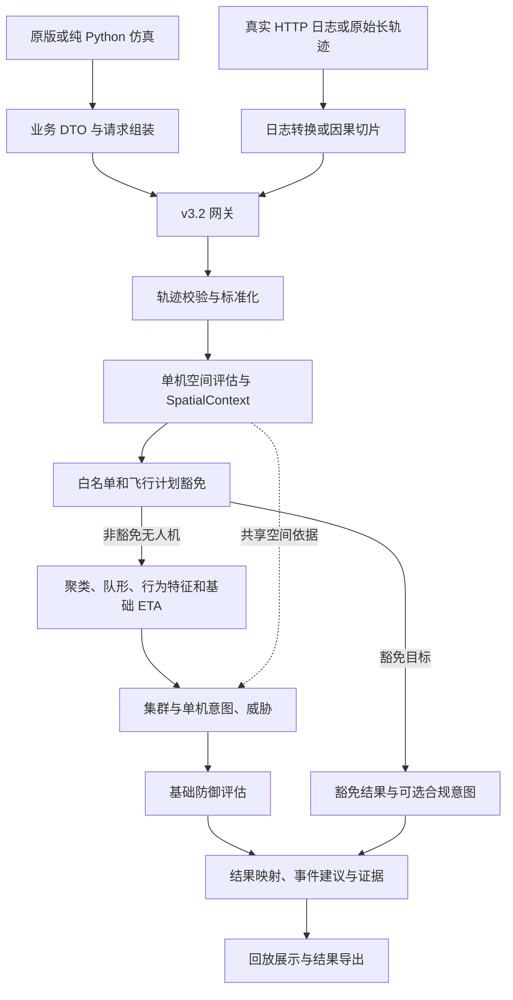

# 项目算法评审参考资料 · project_reference

> 基线日期：2026-10-22（用户所在时区）。适用范围：本地工作树，包括已存在的未提交内容。主仓库 HEAD：`6cd79ef`；latest 子仓库 HEAD：`4598011`。公共契约 v3.2、OpenAPI 3.2.2、规则版本 `situation-rule-v2.3.0`。
>
> 用途：作为项目算法评审 PPT、Word 技术说明和答疑材料的共同事实底稿。本文整理当前代码行为，不修改原始需求定义，不代表线上镜像、真实场景精度或项目终验已经核验。初版编写未重跑算法测试；§12保留历史测量。2026-10-25补充执行12项定向回归和方法中间量复核，见§16，不与历史数量累加。
>
> 当前PPT：32页技术合并版（23页正文＋9页附录）；页码引用已同步，算法事实和历史测试数值未改。

> 配套文件：[PPT 编排脚本][ppt-script]。章节采用固定锚点，公式使用独立编号，后续可直接按章节和公式编号抽取。

> 后续实测补充：2026-10-23 已完成多无人机仿真规模与局部优化对照，见 [§12.5](#r12-5)。该节为新增实验记录；此前各节引用的历史测试数量与时间范围维持原有含义。

## 目录与使用方法

| 章节 | 内容 | 主要用途 |
|---|---|---|
| [§1](#r01) | 项目定位、汇报口径与进展矩阵 | PPT 开场、Word 摘要 |
| [§2](#r02) | 工程关系与真实执行链路 | 总体架构图、技术链路 |
| [§3](#r03) | 输入契约、业务关联与轨迹处理 | 输入边界、预处理 |
| [§4](#r04) | 运动与行为特征 | 算法基础、特征解释 |
| [§5](#r05) | 集群划分及降级 | 聚类技术页 |
| [§6](#r06) | PointNet 队形识别 | 模型技术页 |
| [§7](#r07) | 统一空间上下文 | 多设施一致性 |
| [§8](#r08) | 意图候选、19 项规则与时间一致性 | 意图框架、重点案例 |
| [§9](#r09) | 十维威胁评分 | 评分公式、解释与边界 |
| [§10](#r10) | ETA 与基础防御辅助评估 | 辅助决策能力 |
| [§11](#r11) | 输出、回放与交付 | 集成与可复现性 |
| [§12](#r12) | 已有证据、待开展验证与案例模板 | 实验页、验收依据 |
| [§13](#r13) | 贡献、局限与下一阶段 | 评审结论、计划 |
| [§14](#r14) | PPT 叙事与 Word 组织 | 材料编制方法 |
| [§15](#r15) | 参数、公式、代码与测试索引 | 复核、答疑 |
| [§16](#r16) | 技术图解、网络架构与本轮复核 | 32页技术合并版PPT与Word第23章 |

阅读顺序：项目负责人读 §1、§2、§12、§13；算法评审人员重点读 §3～§10；制作 PPT 时按照配套脚本定位本文小节，不必逐章搬运。

文中“已实现”表示本地有对应运行代码；“已有验证”只覆盖注明的数据与测试；“设计中”表示存在方案或规格但尚未形成完整运行能力。“拟验证”和案例模板均不属于已获得实验结果。

## 1. 项目定位与实际进展

### 1.1 推荐项目名称与开场表述

推荐标题：**低空无人机单机与集群态势判读算法——阶段性算法评审**。

建议开场表述：本项目融合无人机轨迹、身份与飞行计划、设施与空域信息，完成目标集群划分、队形识别、行为与意图判读、威胁分级及基础防御辅助评估。目前已形成输入标准化、算法分析、结构化输出和回放验证的服务链路，可以输出单机与集群结论及对应证据。

本阶段定位为“可运行、可解释、可回放验证的算法基线”。真实场景识别效果、规则参数合理性和概率校准需要独立数据进一步验证。

### 1.2 业务问题与分析对象

| 业务问题 | 算法问题 | 当前输出 |
|---|---|---|
| 哪些目标可能属于同一群体？ | 空间与运动相似性聚类 | 集群 ID、成员列表 |
| 群体呈现什么几何组织？ | 点集分类 | 队形类型或无可靠队形 |
| 目标与防护对象有什么关系？ | 圈层、禁飞区、边界及设施关联 | 单机空间结果和内部 SpatialContext |
| 当前活动表现出什么含义？ | 行为特征与身份、计划、空间规则组合 | 单机／集群意图、候选、证据 |
| 需要什么程度的关注？ | 多维评分、硬规则、空间范围控制 | 威胁分值、等级、复核标记 |
| 已知资源能提供什么辅助信息？ | ETA、点位覆盖和资源约束评估 | 基础资源分配与脆弱性提示 |

分析对象以请求中提供的轨迹为起点。项目当前不负责从原始雷达、视频或射频信号中检测无人机，也不实现底层传感器航迹关联；身份归一化不能介绍成传感器级多目标跟踪。

### 1.3 能力状态矩阵

| 能力 | 当前状态 | 汇报边界 |
|---|---|---|
| v3.2 网关与四类源 DTO 关联 | 已实现 | 结构化业务信息关联；依赖上游数据质量 |
| 轨迹去重、双窗口与质量处理 | 已实现 | 配置门槛通过不代表所有规则历史充分 |
| 可靠度感知 DBSCAN | 已接入 | 当前请求分组；无持续群体身份跟踪 |
| PointNet 五类队形识别 | 已接入 | 双机不做五类分类；无可用结果时降级 |
| 19 项独立意图规则 | 已实现 | 30 项业务分类目录不等于 30 项已实现规则 |
| 单机与集群分别判读 | 已实现 | 群体结论不能机械复制给每一成员 |
| 空间上下文、十维威胁 | 已实现 | 权重与 confidence 尚非真实样本校准概率 |
| ETA、基础防御评估 | 已实现基线 | 近似估计与启发式评估；无全局最优调度证明 |
| 仿真、日志转换、长轨迹回放 | 已实现 | 仿真标签和程序预期不能替代独立真实真值 |
| 容器、INI、地图刷新、版本元数据 | 已有实现与交付说明 | 本次未重建镜像、核验线上容器 |
| 设施趋向与抵达时间预测包 | 设计、Schema 及局部核验 | 完整预测服务尚未实现 |
| 显式仿真 groundTruth 导出 | 已形成规格 | 当前生产者导出尚无该真值块 |
| 图关系、角色推断、多未来预测等路线 | 设计储备 | 未纳入当前运行能力清单 |

## 2. 工程关系与真实算法链路

### 2.1 工程角色

| 路径 | 角色 | 评审使用方式 |
|---|---|---|
| `uav_strategy/` | SPADE／BDI／Redis 原版任务仿真 | 轨迹与场景生产方法 |
| `uav_strategy_pure_py/` | 内存状态、中央轮次循环的纯 Python 仿真 | 当前可复现数据生产路径之一 |
| `situationawareness latest/` | 当前算法服务、请求组装、测试和回放 | 本次算法评审主工程 |
| `SituationAwareness Origin/` | 历史算法与训练参考 | 方法演进和训练素材参考 |
| `uav_facility_bridge_design_v1/` | 趋向与抵达时间预测设计 | 后续研究方案 |

仿真执行任务并产生运动轨迹；判读服务根据观测轨迹推断状态。两者是不同角色，不能把仿真中的已知任务直接称为算法已经识别出的真实意图。

### 2.2 总体信息流：用于 PPT 架构图

图为解释主流程，完整执行顺序及人工修正位置见下一节。非无人机目标具有单独观察／决策豁免分支，不进入通常的无人机处置判读。

### 2.3 实际调用顺序：用于 Word 与答疑

正式入口为 [main_situation_judgment_service.py][main]，路由注册在 [service.py][service]。业务契约称 v3.2，实际 POST 路径仍为 `/api/v1/situation/analyze`；URL 中的 v1 不表示本次契约是旧版。

| 顺序 | 调用或阶段 | 关键行为 |
|---|---|---|
| 1 | `service.analyze_situation()` | 接收 JSON，调用网关，调用引擎，装饰公共响应和身份头 |
| 2 | `normalize_v32_request()` | 校验 DTO、选择请求地图或默认地图，关联身份和计划，形成内部 payload |
| 3 | `SituationEngine.analyze()` 前段 | 计算请求摘要、检查有界幂等缓存，准备 baseData、选项和人工修正上下文 |
| 4 | `_parse_target()` | 校验、时间戳去重、长窗口裁剪、计算基本运动特征，记录跳过目标 |
| 5 | `AirspaceRelationAnalyzer.evaluate_with_context()` | 对解析成功目标做空间评估，产生单机空间结果和内部上下文 |
| 6 | 成员排除与 `_target_exemption()` | 人工成员排除影响聚类和威胁；空间结果仍保留。豁免在聚类前评估 |
| 7 | 豁免分支 | 返回豁免结果，可评估 I-01／02／03／05；不分配反制资源 |
| 8 | `LegacyAlgorithmAdapter.analyze()` | 非豁免无人机短窗口 → UTM 轨迹 → DBSCAN → 群内对齐与 PointNet → 行为特征 → ETA |
| 9 | `_clusters()` | 优先使用适配器分组，无可用分组时回退；生成由成员集合确定的 ID |
| 10 | `_evaluate_cluster()` | 选取空间上下文，计算集群意图与威胁；多成员调用 `_evaluate_target_threat()` 独立判读 |
| 11 | `_apply_threat_overrides()` | 应用当前支持的人工威胁修正；单成员独立改档仍是后续缺口 |
| 12 | `DefenseAnalyzer.evaluate()` | 按当前请求资源，评估覆盖、分配和脆弱性 |
| 13 | `_finalize_correction_results()`、`build_analysis_result()` | 形成修正结果和公共分析 DTO |
| 14 | `_build_target_intent_results()` | 为输入目标汇总独立意图及有效／豁免／跳过等状态 |
| 15 | 响应收尾 | 事件建议、证据、告警、诊断、规则版本；网关补充公共身份与地图诊断 |

“LegacyAlgorithmAdapter”是复用模块的适配层名称，不等于当前仍使用旧 RNN 意图系统。正式意图来自 `intent_rules.py`；适配器只复用旧行为特征，不直接采用旧意图名称。

### 2.4 状态与数据生命周期

- 每次请求携带所需历史轨迹；当前无跨请求轨迹记忆或持续群体跟踪。
- `clusterId` 根据排序后的成员 ID 集合生成；成员改变会改变 ID，同一集合产生相同 ID 不等于完成持续身份关联。
- 模型缓存、有界请求幂等缓存、地图快照属于服务状态，不属于运动历史模型。
- 成员特征缓存为请求局部变量，避免共享服务线程间串用空间与特征结果。
- 防御资源剩余量在一次请求内递减；没有跨请求库存事务或真实装备控制闭环。

## 3. 输入契约、身份关联与轨迹处理

### 3.1 输入信息分组

| 信息组 | 代表内容 | 作用 |
|---|---|---|
| 观测轨迹 | `uavs_coords_str` 内每目标的 `lngs/lats/ts/alts`、轨迹质量 | 运动、聚类、队形与时间特征 |
| 分析时刻 | `snapshotTime` | 有效期和业务时间判断；轨迹子窗口仍按轨迹时间计算 |
| 四类业务源 | `realPersons`、`dronesBySerialNos`、`droneWhitelistDtos`、`flightPlansBySn` | 飞手、设备、白名单、飞行计划关联 |
| 空间信息 | facilities、rings、airspaces | 设施、圈层、禁飞区与业务区域 |
| 能力信息 | defenseResources、detectionDevices | 基础防御和覆盖评估 |
| 控制信息 | options、corrections、ruleConfig | 输出内容、人工修正、允许配置的参数 |

业务关联主轴是 `targetId → serialNo → 设备／飞手／白名单／飞行计划`。公共 v3.2 请求不能直接提交内部 `baseData.whitelist` 和 `baseData.flightPlans`；这两项由网关归一化生成。具体 DTO 字段以 [v3.2 完整协议][protocol]、[OpenAPI][openapi] 为准。

默认地图逻辑：请求未提供有效非空地图组时使用默认地图；请求提供地图时按请求路径处理，不把部分请求地图静默拼成任意默认地图。地图来源进入诊断信息。

### 3.2 时间、坐标和高度

- 公共轨迹时间戳按 Unix 毫秒使用；适配器将其转换为旧运动算法需要的秒。
- 公共坐标为经纬度；聚类与队形适配路径转换到 UTM 平面坐标。部分引擎距离直接使用球面距离。
- 高度参考包含 AGL、AMSL、UNKNOWN；可用地面高程时才能进行相应换算。无法判定的高度不能擅自当成满足某空域高度条件。
- 夜间规则当前按 UTC+08:00 的业务时间判断，与开发电脑时区不同。
- 轨迹末点与 `snapshotTime` 承担不同作用，不能把请求时刻自动当成轨迹最后观测时刻。

### 3.3 去重与窗口

1. 校验数组长度、坐标范围、高度有限性及时间格式。
2. 时间倒序拒绝；相等时间戳允许去重。同一时间戳保留最后完整观测，坐标与高度一起更新。
3. 同一坐标出现在不同时间戳时仍保留，这是悬停证据。
4. 意图历史保留末点之前最近 120 秒，且最多 240 点。
5. 去重后和截窗后均再次检查最低点数。
6. 运动与适配器聚类使用短窗口，默认尾部 12 点。聚类内部稳健运动统计最多用最近 11 个有效运动段。

最低点数来自 [config/service.ini][service-ini] 的 `trajectory.least_point`：允许 2～240，缺项默认 6，本机配置为 2；修改后需重启相关进程。它是入口有效性门槛，不能替代 I-24 等规则的专属时间长度、点数和连续性要求。

可用于图示：同一条时间轴，上方画 120 秒／240 点意图窗，下方画尾部 12 点运动窗；重复时间戳用折叠标记，静止但时间不同的点仍保留。

## 4. 运动与行为特征

### 4.1 基础几何与运动公式

以下为代码行为的数学表达。距离单位米、时长单位秒。符号 \(p_k\) 表示位置，\(t_k\) 表示换算为秒后的时间，\(d(\cdot,\cdot)\) 表示相应路径使用的距离函数。

**F01 · 球面距离。** 引擎经纬度距离采用 Haversine 形式，地球半径 \(R=6{,}371{,}000\,\mathrm{m}\)。经纬度须先转弧度。

\[
a=\sin^2\frac{\Delta\varphi}{2}+\cos\varphi_1\cos\varphi_2\sin^2\frac{\Delta\lambda}{2},\qquad d=2R\arcsin\sqrt{a}.
\]

这里的 \(\varphi\) 为纬度，\(\lambda\) 为经度。向量化跨度计算对浮点范围做截断；UTM 聚类距离不使用这条公式。

**F02 · 运动段速度、路径长度、直线度和跨度。**

\[
v_k=\frac{d(p_{k-1},p_k)}{t_k-t_{k-1}},\quad
L=\sum_{k=1}^{n-1}d(p_{k-1},p_k),\quad
S=\begin{cases}d(p_0,p_{n-1})/L,&L>0\\0,&L=0\end{cases},\quad
D_{\mathrm{span}}=\max_{i,j}d(p_i,p_j).
\]

引擎 `target.speed` 取短窗最后最多三个段速度的平均；聚类使用段速度中位数；I-24 子窗也有自己的速度统计。三个数值的窗口和用途不同，不应统一写成“系统速度”。引擎段速度分母另有最小 0.001 秒保护。

`target.heading` 使用最近一个有效运动方向；位移不足 0.5 米的段不参与航向计算。航向变化取最近最多三个航向差的最大值。

### 4.2 行为特征及解释

| 特征 | 当前含义 | 典型用途与注意事项 |
|---|---|---|
| hoverSeconds | 从末点向前查找连续处于末点 20 米邻域的观测时长 | 是空间邻域持续时间近似，不是单纯速度低于阈值 |
| straightness | 首末点距离与路径长度之比 | 越接近 1 越近直线；单个高值不能独立确认业务意图 |
| trackSpanMeters | 长窗中最大点对距离 | 区分局部活动与大范围运动 |
| facilityClosingMeters | 首点到设施距离减末点到设施距离 | 距离变化量，单位米，不是闭合速度 |
| headingToFacilityDegrees | 当前航向与指向设施方位的夹角 | 航向不可用时采用保守值 |
| orbitAngleDegrees | 围绕关联设施的累计绕转角 | 与距离、路径长度共同参与绕飞规则 |
| jitterScore／repeatScore | 引擎定义的抖动／往复特征 | 启发式特征，不能直接解释为真实概率 |
| sensitiveInsideRatio／scanPatternScore | 敏感区域内占比及扫描模式特征 | 与反转次数等条件组合 |
| legacyBehavior | 复用旧模块的转向等行为结果 | 只作为特征，不直接使用旧意图标签 |

关键实现：[engine.py][engine] 的 `_parse_target()`、`_compute_member_intent_features()`、`_orbit_angle()`、`_jitter_score()`、`_repeat_score()`、`_scan_features()`。轨迹跨度使用向量化成对距离，仍有随窗口长度平方增长的计算／内存开销；向量化不等于改变其渐近复杂度。

## 5. 集群划分：可靠度感知 DBSCAN

### 5.1 问题、输入与标准化

输入为非豁免无人机的短轨迹窗口。目标是把空间邻近且运动关系相容的目标划为群体，同时降低低速抖动、暂时停顿和转向过渡对分组的影响。

`SplitClusters` 提取末位置、稳健方向、稳健速度。位置按配置空间尺度及适宜区间内的目标间距均值标准化；没有适宜间距时使用配置基准。方向按近似航向阈值转换出的单位向量尺度标准化；速度按适宜区间内速度均值或配置典型速度标准化。

本地 [config.ini][algorithm-ini]：`SWARM_MUTUAL_DISTANCE=50`、`SWARM_NEAR_ANGLE_DEGREES=20`、`SWARM_AVERAGE_SPEED=10`、`CLUSTER_SPATIAL_SCALE=1.0`、`DBSCAN_EPS=1.5`。这些属于当前配置基线，不能写成所有场景最优参数。

### 5.2 可靠度与成对距离

稳健速度来自有效段水平速度中位数；方向由有效单位方向的中位数聚合并归一化。低速方向可靠度逐步降低，明显速度过渡或航向过渡可使相应特征可靠度为零。这里的可靠度控制特征贡献，不是概率估计。

**F03 · 可靠度感知成对距离。** 设标准化位置、方向和速度分别为 \(\tilde p_i,\tilde u_i,\tilde v_i\)，单目标方向和速度可靠度为 \(r_i^u,r_i^v\)。

\[
r_{ij}^u=\min(r_i^u,r_j^u),\qquad r_{ij}^v=\min(r_i^v,r_j^v),
\]
\[
D_{ij}=\sqrt{\|\tilde p_i-\tilde p_j\|_2^2+
\left(r_{ij}^u\|\tilde u_i-\tilde u_j\|_2\right)^2+
\left(r_{ij}^v|\tilde v_i-\tilde v_j|\right)^2}.
\]

两个目标只要一方运动特征不可靠，该项差异的贡献就降低；不会把“未知方向”编码成一个与所有有效方向都很远的向量。

随后调用 `DBSCAN(eps=配置值, min_samples=1, metric='precomputed')`。当前 `min_samples=1` 使孤立点能够成为单目标簇；不能介绍成自动把所有孤立点过滤为噪声。该路径显式构造成对距离矩阵，不能笼统宣称整体复杂度为 \(O(N\log N)\)。

### 5.3 降级、结果与限制

适配器没有提供可用分组时，引擎按距离与航向约束构造连通分组，默认距离 250 米、航向差 50 度；缺少航向时不以航向条件排除。超过 10 个无人机时使用地心弦坐标 KD-tree 搜索候选邻居，再进行实际距离和航向检查。候选搜索加速不等于整个正常 DBSCAN 路径采用 KD-tree。

输出为成员列表；ID 为成员集合散列。当前没有跨请求群体合并／分裂身份关联、时序标签平滑或全局轨迹跟踪。

参考实现：[clusters_recognition.py][cluster-code]、[legacy_adapter.py][adapter]、[engine.py][engine] 的 `_clusters()`。可关注的回归文件见 §15.3。

## 6. PointNet 队形识别

### 6.1 输入预处理和适用条件

聚类后，在每个候选集群内部对齐时间戳；要求成员至少有两个共同时间戳，用前后两个位置集合计算平均运动方向。不同集群不必拥有相同时间范围，一个集群无法对齐不应使其他集群失效。

当前正式推理以二维相对位置点集为输入。单机为 `none`；双机路径直接返回 `none`；多于两机时才调用五类 PointNet。五类为 `circular`、`vertical`、`horizontal`、`vshape`、`arc`。它们表示几何队形，不直接证明协同关系或攻击意图。

**F04 · 点集标准化与 PointNet 聚合。** 先依据运动方向旋转至统一方向，再均值居中，按最大绝对坐标归一化。

\[
q_i=R_\theta p_i,\quad \bar q=\frac1N\sum_i q_i,\quad
s=\max_{i,c}|(q_i-\bar q)_c|,\quad
z_i=\begin{cases}(q_i-\bar q)/s,&s>10^{-3}\\q_i-\bar q,&\text{其他}\end{cases}.
\]
\[
h_i=\phi(z_i),\qquad g_c=\max_{i\in\mathcal V}h_{i,c},\qquad
\hat y=\arg\max_k\psi(g)_k.
\]

\(R_\theta\) 为旋转矩阵，\(\mathcal V\) 为有效点集合，\(\phi\) 为逐点特征网络，\(\psi\) 为分类头。最大池化使用长度掩码屏蔽填充点。

### 6.2 当前网络与模型文件

网络：三层核大小为 1 的 Conv1d，各层配 BatchNorm 与 ReLU，隐藏维度 128；全局最大池化；全连接、Dropout 0.3、五类输出。代码没有要求把它描述成包含完整 T-Net 的原论文网络。

当前适配器加载 `pretrained_weights/formation_recognition/form_recog_model_20260812_200622.pth`，诊断名称为 `pointnet_model`。推理结果由 logits 的 argmax 选类；未见该链路提供经过校准的类别概率。

方向无法稳定估计、成员时间不重叠、模型缺失或推理失败时，需要结合诊断识别降级；没有模型结果不能凭空写为“随机队形”。旧 RNN 文件保留作历史兼容参考，当前评审以已配置的 PointNet 主路径为准。

实现：[formation_recognition_pointnet.py][pointnet] 的 `BasicFormProc`、`PointNetClassifier.forward()`、`infer_movements()`；适配与降级见 [legacy_adapter.py][adapter]。

## 7. 空间分析：统一 SpatialContext

### 7.1 为什么需要统一上下文

同一个目标可能靠近多个设施，落在多个圈层或禁飞区内。如果意图、威胁、ETA 各自重新选取不同设施，就可能出现“以设施 A 的运动证据触发意图，却用设施 B 的距离抬高威胁”的不一致。

当前引擎先按目标计算空间关系和内部 `SpatialContext`，再供意图、威胁、ETA 和防御评估复用。上下文包含相关性、圈层状态、主区域、关联设施、方向趋势、规则命中和不确定性。

### 7.2 几何、候选范围与主上下文

空间关系涉及圆／多边形内部判断、最近边界距离、边界进出、运动趋势，以及可用时的高度匹配。默认边界容差 10 米，方向分析短窗 12 点，方向速度阈值 0.5 米／秒；这些是当前规则配置值。

**F05 · 空间关联范围的解释表达。** 对已经通过有效期、几何和高度等筛选的候选，关联原则可概括为：

\[
\mathrm{relevant}(x)=\mathrm{insideApplicableArea}(x)\ \lor\
\left[d(x,\partial A_{\mathrm{outer}})\le R_{\mathrm{assess}}\right],\qquad R_{\mathrm{assess}}=5000\,\mathrm{m}\text{（默认）}.
\]

该式是筛选流程的解释性概括，不替代全部可用性分支。关联距离参考候选防控空域最外层 warning 边界，不能画成固定“设施中心 5 千米圆”。旧地图缺少 warning 时按最低可用圈层回退。禁飞区还有独立的候选与命中逻辑。

候选稳定排序：当前命中优先；命中候选优先考虑严重程度；未命中候选优先最近边界；最后使用确定性标识消除并列。集群再从成员上下文中选取主上下文，并约束参与空间评分的成员集合。

### 7.3 三种状态及业务影响

| 状态 | 意义 | 下游行为 |
|---|---|---|
| relevant | 存在相关空间依据 | 可根据同一上下文计算设施距离、空间意图和 ETA |
| irrelevant | 已知目标超出关联范围 | 本地威胁默认限制在低档上限 35，不做本地 ETA／资源分配 |
| unavailable／uncertain | 空间不足或部分高度关系无法确认 | 保守处理并复核，不能等同空间不相关 |

空间限定只约束相应作用域；集群中某个其他设施方向的成员命中，不能无条件抬高当前主设施的空间意图维度或空间硬规则。防控空域 ID 与法定禁飞区 ID 分别承载，不混用命名空间。

实现：[airspace_analysis.py][airspace] 的 `evaluate_with_context()`、`_candidate_key()`、`_spatial_context()`；[engine.py][engine] 的 `_spatial_context_key()`、`_same_primary_context()`、`_context_facility()`。

## 8. 意图识别：候选规则、证据与时间一致性

### 8.1 当前框架

`IntentFeatureFrame` 汇集单机特征、群体特征、空间状态、豁免和匹配记录。启用规则独立评估并生成 `IntentCandidate`，包含业务代码、confidence、触发成员、优先级、信息完整度和证据。

**F06 · 确定性候选排序。** 对候选 \(c\) 按以下键升序排列：

\[
K(c)=\left(\mathrm{priorityRank}(c),-\mathrm{round}(\mathrm{confidence}(c),8),
-\mathrm{round}(\mathrm{completeness}(c),8),\mathrm{code}(c)\right).
\]

同一意图的重复来源候选去重，保留排序最强项。首项为主意图，其余可作为候选输出。排序优先级只解决同时成立时的选择，不是威胁分；主结果不一定是 confidence 最大项。

没有候选时返回空意图，并在后续判读中要求复核。I-28 当前禁用。法定禁飞区侵入是特殊候选 `NO_FLY_INTRUSION`，可有空 `intentCode`，不能被误当成“无结论”。

### 8.2 19 项已实现规则与未启用项

以下名称沿用业务目录，表示代码中的判读标签，不代表对人的动机作事实认定。条件仅做摘要，完整逻辑以 `_eval_iXX()` 和特征计算为准。

| 代码 | 目录名称 | 当前主要依据 |
|---|---|---|
| I-01 | 已报备巡检 | 有效匹配巡检计划、计划匹配分 |
| I-02 | 已报备航拍／物流／测绘 | 有效计划用途及匹配分 |
| I-03 | 我方系统测试 | 有效系统测试白名单 |
| I-05 | 装备调试 | 调试／维护白名单、小范围持续悬停 |
| I-08 | 新手误操作 | 飞手经验或登记时长代理、高频小幅抖动 |
| I-10 | 未报备航拍 | 地标／景点附近悬停且未走有效豁免分支 |
| I-11 | 未报备飞行 | 明确未登记且未豁免；unknown 不等同 unregistered |
| I-12 | 超高飞行 | 当前 AGL 规则范围；代码候选条件为高于 120 且不超过 1000 米 |
| I-13 | 闯入预警／警戒区 | 成员当前圈层状态 |
| I-14 | 要地侦察（绕飞） | 设施附近、累计绕转角和路径长度 |
| I-15 | 要地侦察（悬停观察） | 关联设施附近持续悬停 |
| I-17 | 异常航线（往复） | 重复特征和路径长度 |
| I-18 | 夜间隐匿飞行 | UTC+08:00 的 20 时至次日 6 时、无有效报备 |
| I-21 | 监狱投送 | 监狱设施关联、距离、趋近和方向等轨迹条件 |
| I-22 | 非法测绘 | 敏感区域覆盖、扫描模式和反转特征 |
| I-24 | 撞击袭击 | 请求内多时刻高速近直线抵近证据及当前运动门控 |
| I-26 | 蜂群协同攻击 | 多成员、同设施、趋近占比、航向与 ETA 一致性 |
| I-29 | 身份不可辨 | 登记状态及身份来源均不可用 |
| I-30 | 闯入反制区 | 当前 core 圈层 |

未纳入首版启用集合：I-04、06、07、09、16、19、20、23、25、27；I-28 禁用。目录保留完整 I-01～I-30，但不能据此写“30 项规则均已实现”。

I-05／I-10／I-15 当前悬停门槛均为 10 秒，且各自仍需满足其他条件。原规格和研发 Excel 中的旧门槛应保留在“原定义”列，另补当前行为。

### 8.3 I-24：同一请求内的因果时间一致性

此处用于说明风险识别规则的现行实现与验证边界。五个评估时刻以轨迹末时刻为基准、相隔 1 秒。每个时刻只使用不晚于它的观测，端点最多允许滞后 1.25 秒；同一端点不能当作多个独立投票。

每个子窗最多 8 秒，至少 4 点、跨度至少 3 秒，相邻采样间隔不超过 2 秒；短航向窗为最近 3 秒。缺失、过旧、重复端点或断档是“不可用”，不能作为有效反例或补成命中。

**F07 · 距离回归闭合速度与时间一致性。** 设观测至同一设施的距离为 \(d_k\)，时间为 \(t_k\)：

\[
v_{\mathrm{close}}=-\frac{\sum_k(t_k-\bar t)(d_k-\bar d)}{\sum_k(t_k-\bar t)^2}.
\]

设第 \(j\) 个评估是否有效为 \(a_j\in\{0,1\}\)，是否满足该次运动判据为 \(b_j\in\{0,1\}\)，且无效时 \(b_j=0\)。最终门控可表达为：

\[
\mathrm{I24Hit}=\left[\sum_{j=1}^{5}a_j\ge3\right]\land
\left[\sum_{j=1}^{5}b_j\ge3\right]\land G_{\mathrm{latest}}.
\]

当前单次判据：速度至少 16 米／秒、直线度至少 0.80、闭合速度至少 5 米／秒、朝向夹角不超过 30 度、设施距离不超过 1200 米。最新门控要求短窗闭合速度至少 2 米／秒、夹角不超过 40 度，仍在同一距离范围内。

这些阈值是代码基线，不是已完成真实数据标定的结论。降低通用 `least_point` 不改变本规则的历史要求。不插值补历史，不使用未来点，不读取上一请求结论；该机制属于请求内时间一致性判据，不是跨请求状态机或 HMM。

讲述图建议：五个时间槽分别标“有效／不足”和“命中／未命中”，再独立画“最新仍抵近”检查。实际图上的命中状态必须来自回放或测试记录；仅用于解释时标注“方法示意”。

实现：[collision_intent.py][collision]、[intent_rules.py][intent] 的 `_eval_i24()`。历史不足可通过 `EV-I24-HISTORY` 等证据定位。

### 8.4 I-26：群体协同特征的现行启发式

群体候选要求至少 3 个成员、至少三分之二成员趋近同一设施、航向离散不超过 25 度、ETA 离散不超过 20 秒。趋近占比使用长窗设施距离减少至少 30 米的成员；该特征不同于 I-24 的回归闭合速度。

航向离散为各有效航向相对于圆均值方向的最大角差，并非线性标准差。ETA 特征按距离除速度计算，取最大与最小差；至少需要两个有效 ETA。

**F08 · 协同评分。** 令 \(f\) 为趋近占比，\(\delta_h\) 为航向离散度，\(\delta_\tau\) 为 ETA 离散秒数：

\[
C_{\mathrm{coord}}=\operatorname{clip}_{[0,1]}\left(0.45f+
0.30\max(0,1-\delta_h/25)+0.25\max(0,1-\delta_\tau/20)\right).
\]

ETA 离散不可用时相应项为零，且不能通过候选条件。当前候选 confidence 为 \(0.64+0.30C_{\mathrm{coord}}\)。这是群体一致性启发式，尚未实现显式通信图、角色推断或学得的协同策略识别。

### 8.5 单机、集群与证据的关系

集群规则使用群体和成员特征，单机规则使用该成员自己的特征和空间上下文。多成员集群通过 `_evaluate_target_threat()` 产生独立成员结果。

- 单机意图入口：`data.targetIntentResults[]`，覆盖每个输入目标的结果或状态。
- 集群意图入口：`data.analysisResult.clusterDtoList[]`，事件建议也携带集群意图。
- 默认返回单机候选；`returnTargetIntentCandidates=false` 隐藏候选列表但保留候选数量。
- 证据应呈现观测值、触发目标、规则代码、候选及缺失原因。confidence 是规则构造值，不等于模型正确率。

## 9. 十维威胁评分与业务路由

### 9.1 评分维度与权重

实现位置为 [engine.py][engine] 的 `_threat()`。现有 [威胁计算 Word][threat-word] 可作为更细的说明参考。

| 维度 | 权重 | 当前取值依据概要 |
|---|---:|---|
| 意图 | 18% | 意图代码查表；特殊禁飞侵入单独处理；空间意图需符合当前作用域 |
| 空域 | 16% | outer／warn／alert／core／hard 对应风险 |
| 高度 | 16% | 成员 AGL 高度分段风险 |
| 行为 | 16% | 规避、释放、长时间悬停等 |
| 趋势 | 6% | 是否趋近、设施距离、圈层进入趋势 |
| 合规 | 12% | 明确未登记、合作性等 |
| 集群 | 7% | 成员数量分档 |
| 机型 | 4% | 机型类别 |
| 载荷 | 3% | 载荷类别与类型 |
| 飞手 | 2% | 飞手风险等级 |

当前代码的权重是固定实现值，不要把整个十维模型描述成可以通过任意配置自由调权。

### 9.2 精确计算顺序

**F09 · 基础加权与飞手偏置。**

\[
S_{\mathrm{raw}}=\sum_{k=1}^{10}w_ks_k+b_{\mathrm{pilot}},\qquad
b_{\mathrm{pilot}}=\begin{cases}+5,&\text{任一成员 high}\\-4,&\text{全部成员 low}\\0,&\text{其他}\end{cases}.
\]

**F10 · 融合置信与扣分。** 令 \(\bar q\) 为成员轨迹质量均值，\(c_I\) 为意图 confidence，\(u=1\) 表示不存在来源冲突，否则 \(u=0\)。

\[
C=\operatorname{clip}_{[0,1]}(0.70\bar q+0.20c_I+0.10u),\qquad
\Delta_C=\begin{cases}-6,&C<0.70\\-3,&0.70\le C<0.85\\0,&C\ge0.85\end{cases}.
\]

其中 0.70／0.85 为默认可配置门槛。该式不等同独立概率融合。

**F11 · 最终得分与等级。** 令 \(F\) 为适用硬规则的最高下限，未命中时为零，\(T_m,T_h\) 为中高等级门槛：

\[
S_0=\operatorname{round}\left(\operatorname{clip}_{[0,100]}(S_{\mathrm{raw}}+\Delta_C)\right),\qquad
S_1=\max(S_0,F),
\]
\[
S=\begin{cases}\min(S_1,T_m-1),&\mathrm{scope}=\mathrm{irrelevant}\\S_1,&\text{其他}\end{cases},\qquad
\mathrm{grade}=\begin{cases}\mathrm{high},&S\ge T_h\\\mathrm{mid},&T_m\le S<T_h\\\mathrm{low},&S<T_m\end{cases}.
\]

默认 \(T_m=36,T_h=66\)。取整遵循 Python `round` 实现。66 在相应硬规则中是下限，不是封顶。空间不相关默认上限为 35；空间未知不套用“确定不相关”的低档封顶。

豁免目标、非无人机目标存在提前返回或独立分支，上述计算链适用于通常的非豁免无人机评分。

### 9.3 硬规则、作用域和路由

| 项目 | 当前行为 | 常见误读 |
|---|---|---|
| R3 | AGL 130～180 米，含端点，触发相应下限 | 写成所有高于 130 米均由 R3 触发 |
| 置信调整 | 先扣分和取整，再应用硬规则下限 | 扣分放在抬底后，导致跌破规则下限 |
| 空间作用域 | 某些高度、行为、距离和意图硬规则仅考察对应成员／上下文 | 用其他设施成员证据抬高当前设施分数 |
| 成员与集群 | 分别计算 | 把群体高风险复制到每个成员 |
| 建议路由 | 结合等级、圈层、行为和意图形成事件／处置建议 | 单凭高分就自动对应最高处置级别 |

复核条件包括来源冲突、低置信、没有意图候选、空间不足或不确定。`eventSuggestions` 是算法建议，不等于业务系统已经创建事件或执行处置。

### 9.4 评分页应如何取材

选择一个可复现样例，提取十维分值、质量、意图 confidence、冲突标记、飞手偏置、硬规则、空间状态和最终等级。使用瀑布式计算图或分步表格展示。没有实际回放数值时保留字段模板，不能自行编一组数值当作项目结果。

## 10. ETA 与基础防御辅助评估

### 10.1 ETA 的两条现行路径

适配器调用 `SingleUavBehavior.estimate_arrive_time()` 提供已有的设施趋近与到达估计；引擎只使用当前相关设施和对应成员的有效估计。在存在多个可用值时取最小值。

没有可用适配器估计，但目标空间相关、正在趋近、有设施和有效速度时，使用直线匀速回退。

**F12 · ETA 回退近似。**

\[
\tau_{\mathrm{fallback}}=\left\lfloor\frac{d_{\mathrm{facility}}}{v_{\mathrm{fallback}}}\right\rfloor,\qquad v_{\mathrm{fallback}}>0.5\,\mathrm{m/s}.
\]

代码的距离来自当前主上下文的设施距离，回退速度取对应作用域趋近判断下的有效成员最大速度，因此它是群体汇总近似，距离和速度未必来自同一成员。方法字段区分 `legacy_arrival_estimator` 与 `straight_line_constant_speed`。

适用限制：不输出完整未来轨迹，不模拟未来转弯、任务变化、绕障或多未来分支。I-26 特征中的距离／速度估计和这里的公共 ETA 选择路径也不是完全相同的计算过程。

### 10.2 点位探测覆盖

当前使用集群成员经纬度均值作为代表点，按设备有效半径判断覆盖。设备须启用，且状态不是 offline／disabled／fault。缺设备时返回 unavailable，不能把未提供数据当成覆盖良好。

**F13 · 当前覆盖合成表达。** 设覆盖该点的设备集合为 \(\mathcal C\)，其输入探测概率为 \(p_i\)：

\[
P_{\mathrm{detect}}=1-\prod_{i\in\mathcal C}(1-p_i).
\]

无覆盖设备时为零；没有覆盖或结果低于 0.60 时提示探测脆弱。该组合具有独立事件假设形式，代码并未证明设备独立或校准输入概率。当前是代表点覆盖评估，不是完整空间盲区重建，也不保证整个集群轮廓都被覆盖。

### 10.3 资源分配及成功率字段的边界

当前算法：集群按威胁等级和分数优先；资源先按启用、有效距离以及响应时间不超过可用 ETA 过滤；ETA 缺失时该时间约束不生效。候选按响应时间、距离排序，按成员数量贪心分配，在同一次请求内减少可用数量。

空间不相关或决策豁免目标不进入本地反制分配。资源只来自输入，不虚构装备清单。输出的 `remainingCount` 是请求内估算，不代表装备库存已发生实际扣减。

成功率字段使用 `legacy_defense_evaluator_adapted`。数量不足时整体成功率为零；单成员使用失败概率乘积的补集；多成员使用旧评估公式的适配表达。它没有完成实际装备效能标定，不宜作为主 PPT 的“拦截成功率成果”。正文介绍资源约束和数据完整性即可，公式细节在答疑时回到 [defense_analysis.py][defense] 核查。

当前实现没有求解全局最优资源调度，也没有接入真实装备指令闭环。

## 11. 输出、回放与工程交付

### 11.1 结果应从哪些字段提取

| 内容 | 提取入口 | 用于评审的方式 |
|---|---|---|
| 集群成员、队形、意图、威胁 | `data.analysisResult.clusterDtoList[]` | 总览表、轨迹叠加标注 |
| 独立单机意图与状态 | `data.targetIntentResults[]` | 展示成员差异及无结果原因 |
| 成员威胁 | `clusterDtoList[].targetDtoList[]` | 对比集群与单机判断 |
| 圈层／禁飞区关系 | `data.targetAirspaceResults[]` | 空间图和进出过程 |
| 豁免与人工修正 | `exemptTargetResults[]`、`correctionResults[]` | 正常活动与人工修正案例 |
| 事件建议 | `data.eventSuggestions[]` | 说明系统如何衔接业务 |
| 诊断和证据 | `algorithmDiagnostics`、warnings、证据链及防御完整性 | 区分模型正常使用、降级和缺失输入 |

具体字段层级以公共协议和实际响应为准；内部 `SpatialContext`、`targetThreats` 不应直接当成对外 DTO。

### 11.2 数据生产与回放闭环

原版和纯 Python 仿真都提供轨迹、计划与任务语义。纯 Python 版本通过中央轮次循环和内存状态替代 Agent 调度、Redis 等依赖。导出包括 `simulationMeta`、`uavs_coords_raw`、`uavs_coords_str`、`plannedRoutes`、`missionMeta` 及空间信息。

请求组装默认优先完整生命周期轨迹 `uavs_coords_raw`。`uavs_coords_str` 是筛选后的同步任务轨迹，其末点不一定是完整任务到达时刻。`GROUND_TRUTH_EXPORT_SPEC.md` 当前是规格，生产代码尚未输出显式 `groundTruth`。

下游 `run_data_pipeline.ps1` 分阶段构建业务 DTO、请求和进程内正式路由回放。真实网络回放另有 HTTP 工具；真实日志通过 `tools/log_to_replay_requests.py` 转成请求包。

长轨迹切片使用多机已观测时间戳的并集，按统一时刻向前取历史。该切片器不插值、不引入未来点，默认 30 点回放窗口，最多 5000 帧。这里的 30 点是回放工具设置，不能与引擎 120 秒／240 点意图窗、12 点运动窗混为一谈。

回放界面能够显示单机和集群结果，并导出结果。适合评审展示的是关键帧和证据变化；完整逐帧数据作为附件留档。

### 11.3 交付与版本可追溯性

- 主服务同进程提供分析与元数据端口 31607，地图刷新端口 31608。
- 地图由空域与禁飞区两源刷新，组合成功后原子替换；失败保留旧地图。地图参数来自 INI，下一轮刷新读取；轨迹点数配置修改需重启。
- 元数据包括 buildId、ruleVersion、实例、minimumTrackPoints、mapFingerprint；用于核对“本次回放到底用了什么”。
- Docker 交付包括镜像、Compose、外部配置和说明；源码路径另依赖模型权重、算法目录与地图／设施配置。
- 健康检查成功仅说明相应端点可达，不证明地图最新、模型精度达标或全量算法测试通过。
- 已有开源材料工具和审查资料；材料存在不等于已经完成正式审核或发布。

本节提供算法交付背景。具体命令、清单和端口绑定应从 [latest README][latest-readme]、[部署说明][deploy] 提取；本次没有进行部署操作。

## 12. 验证证据、案例和下一步实验

### 12.1 已有证据及其能支持的结论

| 证据 | 时间／范围 | 可以说明 | 不能说明 |
|---|---|---|---|
| 本地代码及配置核对 | 2026-10-22 基线 | 实际调用、参数、启用集合与边界 | 在线版本相同、真实准确率 |
| 56/56 定向测试通过 | 本轮对话前序检查；下表五组 | 指定条件和回归用例通过 | 全量测试全绿、真实数据精度达标 |
| 历史回放产物 | 不同 71 帧／76 帧数据版本 | 特定请求包可回放、可核查输出 | 跨样本泛化、独立标注准确率 |
| HANDOVER 历史全量检查 | 2026-10-11 | 记录当时发现的问题 | 当前已全部修复或已重新验收 |
| 桥接设计数学／Schema 检查 | 设计包历史记录 | 局部数学和数据契约检查 | 完整预测器效果 |

前序定向测试构成：

| 测试文件 | 通过数 |
|---|---:|
| `test_collision_intent.py` | 23 |
| `test_track_config.py` | 3 |
| `test_track_timestamp_dedup.py` | 7 |
| `test_v1_intent_rules.py` | 16 |
| `test_map_refresh_service.py` | 7 |
| 合计 | 56 |

HANDOVER 中的历史全量检查曾记录 388 项发现口径，并留有 1 项 71／76 帧断言失败、2 项测试导入错误。本次文档工作未重跑全量测试，不能删除该历史边界后宣称全量通过。

历史性能报告有不同硬件、模型推理与端到端测量口径；部分向量化加速报告还比较了测量值与旧路径估算值。本资料不把这些数字作为统一性能指标。拟正式展示性能时，需重新固定硬件、模型、配置、数据量、冷启动／热启动和统计口径。

### 12.2 评审案例组织模板

建议用同一套数据中的三个案例，每个至少展示一个关键时刻和判定依据；这张表是制作任务，不是新增实验结论。

| 案例 | 展示目的 | 必须提取的证据 |
|---|---|---|
| C01 正常／豁免目标 | 证明正常业务可以获得合理解释 | 有效计划／白名单、匹配信息、豁免与合规意图 |
| C02 明显风险证据目标或群体 | 串联聚类、空间、意图和评分 | 轨迹、成员、上下文、候选、规则命中、分值计算 |
| C03 历史不足或行为改变 | 展示算法边界和复核机制 | 有效点数、时间连续性、无候选原因、最新状态、诊断 |

每个案例的留档字段：案例 ID、输入文件路径和哈希、输出文件路径和哈希、代码提交及未提交差异、规则版本、模型文件及哈希、配置与地图指纹、时间区间、预期结论及其标注来源、实际结果、差异解释。

PPT 截图至少标注案例 ID、时刻、关键配置和“实际回放／方法示意”。不要把动画、手绘轨迹或未经独立标注的仿真任务标签当作真实实验结果。

### 12.3 待开展的效果验证

| 模块 | 建议数据与指标 | 需要防止的评价偏差 |
|---|---|---|
| 聚类 | 标注成员归属；成对聚类精确率／召回率、分组稳定性、错误合并／拆分 | 只用成员不变的理想编队样本 |
| 队形 | 独立训练外轨迹与群规模分层；混淆矩阵、各类召回率、macro-F1 | 同一仿真模板或高度相似轨迹跨训练测试泄漏 |
| 意图 | 专家标注场景；每类精确率／召回率、误报、漏报、首次触发延迟 | 按规则自身生成标签，再验证规则正确率 |
| 威胁 | 专家等级与依据；一致率、等级混淆、排序合理性、参数敏感性 | 把规则分数当作真实损失概率 |
| 空间 | 多设施、重叠空域、边界、未知高度的确定性案例 | 只测单设施同心圆 |
| ETA | 有明确实际抵达事件的轨迹；绝对误差、偏差与无效输出比例 | 将未抵达、改航或观测截断样本当作正常抵达 |
| 性能 | 固定设备、目标数量和窗口长度；P50／P95、吞吐、内存 | 混用冷启动和热启动、模型耗时和 HTTP 耗时 |
| 降级 | 缺权重、无时间重叠、断档、身份冲突、缺设备 | 只统计正常响应而不检查结论和诊断 |

以上为拟定验证方案，指标目标值待公司验收要求确认。完成数据准备后再给出准确率、误报率及实时性承诺。

### 12.4 建议的对照实验

聚类可比较“位置距离”“位置＋运动特征”“加入可靠度”的结果；I-24 可比较单时刻判据与现有时间一致性门控；空间模块可测试共享上下文前后的跨设施一致性。对照组必须可运行、使用同一输入和评估标签，再报告差异。

### 12.5 多无人机仿真性能与优化对照（2026-10-23 新增实测）

完整方法、全部表格及边界见 [仿真性能测试报告](simulation_benchmark_20261023/仿真性能测试报告.md)；原始逐次结果见 [results.json](simulation_benchmark_20261023/results.json)。生成及执行程序为 `situationawareness latest/tools/benchmark_simulated_swarm.py`，72 个输入文件及哈希清单保存在 `simulation_benchmark_20261023/`。

**统一条件**：Windows 11、CPU 32 逻辑核、PyTorch 16 线程、Python 3.12.3、NumPy 1.26.4、PyTorch 2.5.0；启用向量化；Flask 进程内正式路由、串行、热态、不同 requestId。目标数 10/50/100/200，每架输入 30/120/240 点，两种布局、三个随机种子。24 组各记录 24 次，共 576 次计时请求，全部业务成功且无跳过或豁免目标；正常 DBSCAN、PointNet、行为提取均实际使用。

**窗口边界**：输入采样间隔 1 秒。当前运动窗口 12 点；意图窗口最近 120 秒且最多 240 点，因此 30/120/240 点输入实际保留 30/120/121 点意图轨迹，适配器使用末尾 12 点。本实验没有覆盖正式链路内 240 个有效意图点的高频采样情形。

每架输入 120 点时，路由中位数和 P95 如下（毫秒；P95 使用最近秩）：

| 目标数 | 分散布局中位数 | 分散布局 P95 | 密集布局中位数 | 密集布局 P95 |
|---|---:|---:|---:|---:|
| 10 | 56.07 | 65.82 | 58.52 | 67.78 |
| 50 | 246.25 | 280.91 | 240.32 | 247.18 |
| 100 | 461.26 | 579.88 | 430.90 | 466.34 |
| 200 | 911.64 | 1181.71 | 859.13 | 935.11 |

**局部优化证据与限定**：

- 轨迹跨度：120 点时成对循环 4.64 ms、生产矩阵代码块 0.23 ms，耗时比 20.07 倍；240 点时 20.79 ms 对 0.86 ms，24.09 倍。各长度 5 条轨迹的最大绝对差小于 \(2\times10^{-9}\) 米。仍是 \(O(W^2)\) 计算与矩阵内存，局部收益不等于整请求收益。
- KD-tree 回退分组：分散布局下，50/100/200 目标分别约 2.85/4.36/10.68 倍；三种子均与朴素连通分组参考得到相同成员集合。密集布局下当前路径约慢 3～4 倍；邻居分布影响收益。测试隔离了后续集群评估，且当前路径额外包含簇 ID 和排序；不代表正常 DBSCAN 的加速或复杂度变化。
- 单机行为特征：100 目标、直接输入 120 点时，旧路径 57.85 ms、向量化路径 4.40 ms，耗时比 13.16 倍。但 100 目标中有 6 个加速判定、3 个转向判定不同，置信度定义亦有差异，因此不能称为完全等价的纯加速；直接组件窗口也不同于正式路由的 12 点输入。
- 请求内成员特征缓存：100 目标、120 输入点时，两种布局耗时比均约 1.19 倍，相当于路由中位数降低约 16%；底层特征计算由每请求 200 次降为 100 次。独立保存响应并复核后，差异仅在调试墙钟时间 `debug.generatedAt`，算法输出一致。原始比较与差异复核均保留。

**评审引用口径**：以上支持指定 CPU 和仿真输入下的计算性能结论。不能用作真实场景准确率、并发吞吐、网络部署时延或公司验收达标证明。后续重点为部署环境与并发、长时间尾部延迟、独立进程冷启动、高频 240 点窗口，以及真实标注数据。旧 Word 文档中的 13 目标测量属于另一组输入与时间，不与本组直接计算加速比。

PPT 当前可展示方法差别和回归样例，尚无实验结果的对照页要保留为后续计划，不提前填写改善比例。

## 13. 项目贡献、当前边界和推进顺序

### 13.1 建议归纳的四项工作贡献

1. **轨迹与群体分析适配。** 对轨迹质量、异步时间和运动可靠度作明确处理，将 DBSCAN 和 PointNet 接入业务链路。
2. **可解释的业务判读。** 以独立候选、触发成员、时间证据和稳定排序连接运动现象与业务规则。
3. **跨模块结果一致性。** 用统一空间上下文约束意图、威胁和 ETA，分别保留集群与成员判断。
4. **可复现的工程交付。** 串联仿真、业务请求、正式服务、日志回放、配置和版本追踪。

DBSCAN、PointNet 属于采用的基础方法。项目工作重点是特征与度量适配、规则实现、空间约束、证据组织、工程集成和验证，不应将基础算法本身列为原创发明。若后续需要论文级创新表述，应补充文献比较与受控实验。

### 13.2 尚待完成或验证的能力

- 独立真实数据集、意图标注、阈值与威胁评分标定、系统效果验收。
- 跨请求持续群体身份、合并／分裂跟踪、完整未来轨迹与多未来预测。
- 设施趋向与抵达预测完整服务；当前设计包的局部检查不能覆盖这一目标。
- 仿真显式真值导出与训练／测试隔离的数据闭环。
- 正式违规解除、单成员威胁人工改档等业务缺口。
- 基础防御估计的设备参数标定、全局调度与实际业务闭环。
- 历史全量测试问题的整理和重新验证，以及规则／Excel 当前注释的持续同步。

### 13.3 推荐的推进顺序与评审事项

先冻结评审基线和案例，再补独立标签与模块指标，随后处理参数敏感性和失败案例，最后按业务优先级扩展预测、持续跟踪和群体建模。每阶段以可核验输出完成：版本清单、案例包、测试报告、标注规范、评估报告或可调用服务。

建议评审会上确认：当前能力范围是否满足阶段目标；哪些数据由公司提供；误报、漏报和时延指标如何定义；哪些规则差异需要产品确认；下一阶段优先完成哪项能力。这里是材料组织建议，不替用户设定项目承诺日期。

## 14. PPT 与 Word 的编制方法

### 14.1 PPT 叙事和页面原则

采用“业务问题 → 已有能力 → 真实链路 → 关键算法 → 可复现案例 → 验证和下一阶段”的顺序。当前采用23页正文、9页答疑附录，共32页。相邻计算环节按方法、计算与结果合并，保留核心结构图、公式和验证边界。实际汇报时长需按试讲确定。

八个算法模块中，重点解释可靠度聚类、PointNet 输入与模型、统一空间上下文、候选与时间一致性、十维评分。ETA 和防御以当前基础能力为主。接口字段、详细参数、全规则目录和代码路径放 Word 或附录。

建议颜色语义：已实现使用蓝色，已核验结果使用绿色，待验证使用橙色，设计中使用灰色；同时写文字状态，不依赖颜色传达含义。空间地图、候选流程、时间轴和评分图采用相同目标 ID 与案例 ID。

### 14.2 Word 推荐章节与内容来源

现有Word为52页完整说明，保留算法、性能结果和第23章技术图解。本轮仅同步PPT引用；下表保留原始章节规划供结构对照。

| Word 章 | 内容 | 本参考资料来源 |
|---|---|---|
| 1 项目概述 | 场景、目标、版本、范围 | §1、§13 |
| 2 数据与术语 | 时间、坐标、高度、身份、有效性 | §3、§4 |
| 3 总体设计 | 工程关系、真实调用、状态管理 | §2 |
| 4 算法设计 | 聚类、队形、空间、意图、威胁、ETA、防御 | §4～§10 |
| 5 规则与参数 | 原定义、实际行为、启用状态、参数依据 | §8、§9、§15 |
| 6 验证与结果 | 已有证据、案例、待开展实验 | §12 |
| 7 工程实现 | 输出、回放、配置、交付 | §11 |
| 8 阶段结论 | 贡献、限制、计划与验收事项 | §13 |

算法小节统一模板：问题定义、输入输出、方法公式、处理步骤、参数来源、异常与降级、验证结果、实现位置。本文公式可作为初稿；Word 排版时使用原生公式，正文内符号保持数学格式。

### 14.3 规则规格书和研发 Excel 的同步原则

保留原始定义及原来的立项含义，在相关条目后追加“当前实现／状态／差异说明／代码或测试依据／同步日期”。Excel 优先用可见列承载，单元格批注只作补充。两份规格书、两份 Excel 原本不完全相同，不宜直接互相覆盖。

| 条目 | 原定义 | 当前行为 | 维护方式 |
|---|---|---|---|
| I-05／10／15 | 原表保留旧悬停阈值 | 当前均以 10 秒为对应时间门槛，且有其他条件 | 分别注明规则条件与待标定状态 |
| I-28 | 原目录兜底意图 | 当前禁用，无候选时空意图并复核 | 保留需求，新增实现状态 |
| 飞手偏置 | 旧说明中的负 3 | 当前全部 low 为负 4、任一 high 为正 5 | 注明公式版本和代码函数 |
| R3 | 原说明中的高于 130 米 | 当前独立 R3 为 130～180 米含端点 | 保留原描述，记录实际区间 |

本次仅生成参考资料与编排脚本，没有修改上述规格书或 Excel。

## 15. 参数、公式与源文件索引

### 15.1 参数来源速查

| 参数 | 当前基线 | 来源与修改性质 |
|---|---|---|
| 最低轨迹点数 | 本机 2，缺项 6，范围 2～240 | `config/service.ini`；进程重启 |
| 意图窗口 | 120 秒、最多 240 点 | engine 常量 |
| 运动窗口 | 默认 12 点 | `DEFAULT_RULE_CONFIG` |
| DBSCAN eps／min_samples | 配置 1.5／代码 1 | config.ini／聚类实现 |
| 距离与航向回退门槛 | 默认 250 米／50 度 | 引擎规则配置；不是 DBSCAN 度量的同义参数 |
| PointNet 输入／隐藏／类别 | 2／128／5 | PointNet 模块与匹配权重 |
| 空间关联范围 | 默认 5000 米 | 规则配置；参考空域外边界 |
| 空间边界容差 | 默认 10 米 | 规则配置 |
| 三项悬停时间 | 10 秒 | `intent_rules.py`；另有各自条件 |
| I-24 窗口／时刻／票数 | 8 秒子窗、5 时刻、至少 3 有效和 3 命中 | `collision_intent.py`，详见 §8.3 |
| 中／高威胁阈值 | 默认 36／66 | 规则配置 |
| 融合置信扣分门槛 | 默认 0.70／0.85 | 规则配置 |
| 回放切片窗口／帧上限 | 默认 30 点／5000 帧 | 回放模块；不是引擎窗口 |

### 15.2 公式索引与推荐展示位置

| 编号 | 公式内容 | 所在小节 | 推荐用途 |
|---|---|---|---|
| F01 | 球面距离 | §4.1 | Word、技术答疑 |
| F02 | 速度、路径、直线度、跨度 | §4.1 | PPT第5页直线度与特征；其他细节保留Word |
| F03 | 可靠度成对距离 | §5.2 | PPT第8页复合距离；附录A2 |
| F04 | 点集标准化、最大池化与分类 | §6.1 | PPT第10–11页点集标准化与网络；附录A3 |
| F05 | 空间关联原则 | §7.2 | PPT第6–7页空间关系；附录A4 |
| F06 | 候选排序 | §8.1 | PPT第12页候选选择 |
| F07 | 闭合速度与时间一致性 | §8.3 | PPT第13页历史投票与最新门控 |
| F08 | 群体协同分 | §8.4 | PPT第14页群体一致性 |
| F09 | 十维加权与偏置 | §9.2 | PPT第15页评分与复算；附录A6 |
| F10 | 置信与扣分 | §9.2 | PPT第15页修正顺序；附录A6 |
| F11 | 抬底、空间限制与分级 | §9.2 | PPT第15页约束顺序；附录A6 |
| F12 | ETA 回退 | §10.1 | PPT第16页三条时间路径 |
| F13 | 点位探测合成 | §10.2 | PPT第17页覆盖组合；附录A7 |

### 15.3 源文件与测试索引

文件定位优先使用函数名，避免代码增删造成行号失效。测试文件“存在”与“本次已运行”分开；仅 §12.1 五组有本轮对话的已运行结果。

| 证据 ID | 源文件／函数 | 核验内容 |
|---|---|---|
| S01 | [service.py][service]：`register_situation_routes()` | 路由、网关与响应 |
| S02 | [v32_gateway.py][gateway]：`normalize_v32_request()` | DTO、地图与身份归一化 |
| S03 | [engine.py][engine]：`analyze()`、`_parse_target()` | 主链路、窗口、结果 |
| S04 | [legacy_adapter.py][adapter]：`analyze()`、`_recognize_formations()` | 复用算法和群内时间对齐 |
| S05 | [clusters_recognition.py][cluster-code]：`_robust_motion_components()`、`_pairwise_feature_distances()` | 聚类公式 |
| S06 | [formation_recognition_pointnet.py][pointnet] | 点集预处理和模型 |
| S07 | [airspace_analysis.py][airspace]、engine 上下文函数 | 空间范围与主上下文 |
| S08 | [intent_rules.py][intent]、[intention_catalog.py][catalog] | 候选、启用集合和业务目录 |
| S09 | [collision_intent.py][collision] | 请求内时间一致性 |
| S10 | [engine.py][engine]：`_threat()` | 十维、置信、硬规则、ETA |
| S11 | [defense_analysis.py][defense] | 点位覆盖和资源约束 |
| S12 | [trajectory_replay.py][replay] | 长轨迹切片 |
| S13 | [HANDOVER.md][handover]、[对齐审查][audit] | 历史验证与差异 |

相关测试文件可在 [tests 目录][tests] 查找：`test_cluster_feature_regression.py`、`test_cluster_preprocessing_regression.py`、`test_cluster_distance_regression.py`、`test_airspace_analysis.py`、`test_v1_intent_rules.py`、`test_v1_intent_feature_extraction.py`、`test_collision_intent.py`、`test_track_config.py`、`test_track_timestamp_dedup.py`、`test_map_refresh_service.py`、`test_agents02_cluster_replay_regression.py`。测试范围以文件内断言为准。

制作材料前的核对清单：记录工作树基线；检查在线元数据（若演示在线服务）；固定案例与地图；区分模型正常／降级；核对公式顺序；区分规则命中与真实精度；保留失败案例；将 PPT 中每个数字关联到来源。

[ppt-script]: <F:/CASIA/Drone Swarm Situational Awareness Algorithm/Collective Intelligence Brain/ppt编排脚本.md>
[main]: <F:/CASIA/Drone Swarm Situational Awareness Algorithm/Collective Intelligence Brain/situationawareness latest/main_situation_judgment_service.py>
[service]: <F:/CASIA/Drone Swarm Situational Awareness Algorithm/Collective Intelligence Brain/situationawareness latest/situation_judgment/service.py>
[gateway]: <F:/CASIA/Drone Swarm Situational Awareness Algorithm/Collective Intelligence Brain/situationawareness latest/situation_judgment/v32_gateway.py>
[engine]: <F:/CASIA/Drone Swarm Situational Awareness Algorithm/Collective Intelligence Brain/situationawareness latest/situation_judgment/engine.py>
[adapter]: <F:/CASIA/Drone Swarm Situational Awareness Algorithm/Collective Intelligence Brain/situationawareness latest/situation_judgment/legacy_adapter.py>
[cluster-code]: <F:/CASIA/Drone Swarm Situational Awareness Algorithm/Collective Intelligence Brain/situationawareness latest/formation_recognition/clusters_recognition.py>
[pointnet]: <F:/CASIA/Drone Swarm Situational Awareness Algorithm/Collective Intelligence Brain/situationawareness latest/formation_recognition/formation_recognition_pointnet.py>
[airspace]: <F:/CASIA/Drone Swarm Situational Awareness Algorithm/Collective Intelligence Brain/situationawareness latest/situation_judgment/airspace_analysis.py>
[intent]: <F:/CASIA/Drone Swarm Situational Awareness Algorithm/Collective Intelligence Brain/situationawareness latest/situation_judgment/intent_rules.py>
[catalog]: <F:/CASIA/Drone Swarm Situational Awareness Algorithm/Collective Intelligence Brain/situationawareness latest/situation_judgment/intention_catalog.py>
[collision]: <F:/CASIA/Drone Swarm Situational Awareness Algorithm/Collective Intelligence Brain/situationawareness latest/situation_judgment/collision_intent.py>
[defense]: <F:/CASIA/Drone Swarm Situational Awareness Algorithm/Collective Intelligence Brain/situationawareness latest/situation_judgment/defense_analysis.py>
[service-ini]: <F:/CASIA/Drone Swarm Situational Awareness Algorithm/Collective Intelligence Brain/situationawareness latest/config/service.ini>
[algorithm-ini]: <F:/CASIA/Drone Swarm Situational Awareness Algorithm/Collective Intelligence Brain/situationawareness latest/config.ini>
[protocol]: <F:/CASIA/Drone Swarm Situational Awareness Algorithm/Collective Intelligence Brain/situationawareness latest/文档/态势判读算法单接口协议-v3.2.md>
[openapi]: <F:/CASIA/Drone Swarm Situational Awareness Algorithm/Collective Intelligence Brain/situationawareness latest/文档/openapi-situation-analyze-v3.2.yaml>
[threat-word]: <F:/CASIA/Drone Swarm Situational Awareness Algorithm/Collective Intelligence Brain/situationawareness latest/文档/SituationEngine威胁值计算详解.docx>
[replay]: <F:/CASIA/Drone Swarm Situational Awareness Algorithm/Collective Intelligence Brain/situationawareness latest/visualization/trajectory_replay.py>
[latest-readme]: <F:/CASIA/Drone Swarm Situational Awareness Algorithm/Collective Intelligence Brain/situationawareness latest/README.md>
[deploy]: <F:/CASIA/Drone Swarm Situational Awareness Algorithm/Collective Intelligence Brain/situationawareness latest/deploy/README.md>
[handover]: <F:/CASIA/Drone Swarm Situational Awareness Algorithm/Collective Intelligence Brain/situationawareness latest/文档/HANDOVER.md>
[audit]: <F:/CASIA/Drone Swarm Situational Awareness Algorithm/Collective Intelligence Brain/代码与文档对齐审查_2026-10-22.md>
[tests]: <F:/CASIA/Drone Swarm Situational Awareness Algorithm/Collective Intelligence Brain/situationawareness latest/tests>

## 16. 技术图解与实现复核（2026-10-25）

对应32页技术合并版PPT、Word第23章（原44页图解细节保留）；既有性能矩阵未重跑，12项定向回归与历史103项重叠，不累加。

### 16.1 身份实体关联与有效性判定

PPT第4页；Word第23.1节。

身份关联以目标ID绑定的规范化SN为主轴，关联设备、飞手、白名单和计划。完整度衡量四项信息是否存在，有效性则检查状态与时间。过期记录依然是存在的证据。同SN多条有效设备记录会拒绝请求；重复有效白名单或型号冲突会禁用相应豁免，并留下诊断。登记未知与明确未登记分别处理。

关联完整度与有效性分开保存。SN、RemoteID、设备记录、飞手记录四项存在性形成完整度；有效状态和时间窗口另作校验，过期记录不能被改写成“从未提供”。飞手由设备的personId关联，不是直接按目标位置猜测。详见v32_gateway.py的身份源归一化。

\[
C_{id}=\frac{I_{SN}+I_{RemoteID}+I_{device}+I_{person}}{4}
\]

实现与证据：`v32_gateway.py normalize_identity_source；本轮身份分支回归`。

### 16.2 聚类前逐目标豁免与计划匹配

PPT第4页；Word第23.2节。

目标先经过有效白名单、演练允许清单和飞行计划判断，按此优先级选择豁免原因。飞行计划需要身份时间、当前位置航线容差与高度匹配，多条命中按横向偏差、申报时间和ID排序。长窗计划匹配分是航线和高度同时匹配的点数比例，用于合规意图证据，不等同豁免所需的全窗门槛。合法目标在聚类前移出，避免为邻近未报备目标一并豁免。

当前点匹配与长窗比例对应不同用途：前者参与计划豁免门控；后者汇总历史轨迹点中航线与高度同时匹配的比例，为合规规则提供证据。不能将比例分数直接当成当前计划有效的充分条件。图中多分支汇入同一独立豁免输出，优先级仍按从左到右执行。

\[
S_{plan}=\frac{1}{n}\sum_{k=1}^{n}\mathbf{1}[routeOK_k\land altitudeOK_k]
\]

实现与证据：`engine.py _target_exemption / _plan_match_score`。

### 16.3 DBSCAN 邻域与实际分组机制

PPT第8页；Word第23.3节。

先由轨迹计算标准化复合距离，再用预计算矩阵执行DBSCAN。当前min_samples为1，自身在邻域内，因此每个有效目标都能成为核心点，孤立目标也成簇。对当前对称距离矩阵，可将结果理解为阈值邻接图的连通分量。注意链式连接可能将端点距离较远的目标连接在同一簇。右图是算法解释图，阈值是归一化复合距离，不是地图米数。

标准DBSCAN以密度可达关系扩展簇；本项目min_samples=1是一个重要特殊配置。邻域包含自身，因此每个有效目标都是核心点，单目标也可成簇。A与C即使超过阈值，只要存在A—B—C的邻接链，仍属于同一簇。这个设置应在评审中说明，不能笼统称为“去除噪声点的密度聚类”。

\[
N_\varepsilon(i)=\{j:D_{ij}\leq\varepsilon\},\quad\varepsilon=1.5
\]

实现与证据：`clusters_recognition.py _make_clustering；Ester等 KDD 1996`。

### 16.4 稳健运动统计与成对可靠度距离

PPT第8页；Word第23.4节。

短窗口中有效水平速度用中位数，单位方向用逐分量中位数后归一化，最多11段。低速时方向可靠度下降，启停速度过渡或明显转向会暂时关闭相应差异。成对可靠度取两目标可靠度最小值。这样一方方向未知时，不会因为零向量编码反而产生伪差异。位置尺度、方向尺度和速度尺度分别归一化，参数是当前配置基线。

位置按候选点对距离的有效区间均值缩放，无有效点对时使用配置尺度；方向按允许角度对应的单位向量弦长缩放；速度按有效速度区间均值缩放。方向可靠度在稳定运动时随水平中位速度线性增加并截断到0至1；启停或明显转向过渡时关闭方向贡献。速度可靠度只在启停过渡时归零。成对贡献使用两侧可靠度较小值后再平方，不能把未知方向简单编码成零向量并按普通欧氏距离处理。

\[
r_{ij}=\min(r_i,r_j)
\]

实现与证据：`clusters_recognition.py _robust_motion_components / _pairwise_feature_distances`。

### 16.5 三类运动场景的聚类回归实值

PPT第9页；Word第23.5节。

三列来自已有回归固定输入的真实执行。第一组一个目标最后一帧转向，方向可靠度归零但仍与稳定同伴成组。第二组悬停和缓行，方向不被强行放大。第三组持续相反方向，运动差异稳定存在，应分为两个单机簇。显示的是这三例的行为，不是大样本聚类准确率。本轮选定12项回归通过，与历史103项存在重叠，不累加。

三例固定输入的复合距离分别为1.000000、1.000050、5.844950；阈值为1.5。前两例输出同簇，持续反向例输出两个单机簇。左图和右图的菱形代表轨迹末点。每列采用独立等比缩放，不能比较不同列的绘图长度推断速度。完整坐标、可靠度、距离矩阵和标签保存在method_evidence.json。

实现与证据：`method_evidence.json；现行SplitClusters；本轮实际执行`。

### 16.6 队形输入的时间对齐与空间标准化

PPT第10页；Word第23.6节。

这里所有颜色始终表示相同成员，来自同次五成员案例。先取群内共同时间戳的前后两个位置集合，用平均位移估计方向，随后旋转到统一方向、均值居中和最大绝对坐标归一化。前帧主要用于方向计算，网络实际输入是当前二维点集。各子图独立等比缩放，所以尺度变化应由标注解释，不能从图上直接比较距离。归一化结果与正式类BasicFormProc逐点一致。

归一化分母是居中坐标所有元素的最大绝对值；大于0.001时才执行除法。当前正式输入为二维坐标，前一共同时间帧用于估计群体方向，当前共同时间帧才构成分类点集。群内不具备两个共同时间戳时须走明确降级分支。五类几何队形不直接等价于真实协同行为。

\[
q_i=R_\theta p_i,\quad z_i=(q_i-\bar q)/\max_{i,c}|(q_i-\bar q)_c|
\]

实现与证据：`method_evidence.json pointnet；BasicFormProc；同次五成员输入`。

### 16.7 PointNet 实际网络结构与张量维度

PPT第11页；Word第23.7节。

这张图按实际forward绘制。输入张量为B乘N乘2，先转置后依次经过三层核大小1的卷积，各层带BN和ReLU。每点共享同一组权重，保留N个点的128维特征。lengths掩码把填充位置从最大池化中排除，聚合为B乘128。分类头使用128维全连接、ReLU、Dropout0.3及五类输出。推理在eval模式关闭Dropout，通常逐群B为1。本网络没有T-Net，参数总数51333。

三层Conv1d的卷积核均为1，逐点共享参数，不沿点序卷积。掩码在池化前屏蔽补齐点；最大池化使输出在理论上不依赖点的排列。当前代码没有原始PointNet论文中的输入T-Net或特征T-Net，因此图中不补画不存在的网络模块。51,333个可训练参数来自实际模型求和，不含BN运行均值和方差。

实现与证据：`PointNetClassifier.forward；input=2，hidden=128，classes=5`。

### 16.8 模型训练方法与当前可核验证据

PPT第11页及第26页（附录A3）；Word第23.8节。

Origin保留变长点集训练代码：独立训练和评估文件，补齐与长度掩码，交叉熵，Adam和基于验证损失的学习率调度，并输出分类报告与混淆矩阵。这说明训练方法可追溯，但本轮没有重训，也没有找到足以确认当前权重90.5%准确率的成套记录。当前实际可报告的是权重、架构、参数量、固定案例输出，以及一个成员逆序的一致性检查。逆序最大logits差约9.54e-7属于浮点量级，不等于严格逐位相同。

卷积参数量依次为384、16,512、16,512；三层BN的可训练参数合计768；两个全连接分别16,512和645。固定五成员输出vshape，逆序输入的logits最大绝对差为9.5367431640625×10⁻⁷。此结果仅支持该样本的数值一致性；代码注释中的acc 0.905没有完整独立评估记录，不能写成当前系统准确率。

\[
\mathcal L=-\frac1B\sum_b\log\frac{\exp(o_{b,y_b})}{\sum_k\exp(o_{b,k})}
\]

实现与证据：`Origin fit_on_data / eval_accuracy；当前权重20260812_200622`。

### 16.9 空间几何与边界距离趋势

PPT第6页；Word第23.9节。

几何分析同时考虑圆与多边形、最近边界、当前内外关系和高度匹配。趋势回归使用实际时间而非点序号。距离是到边界的非负距离，在区域外下降表示接近边界，在区域内下降表示向出口运动。只有运动条件满足时才推算边界穿越时间，未知高度不会被强行判为命中。右图是解释性数据，不能当独立测试结果。

趋势拟合的自变量是轨迹真实时间。边界距离为非负值，需结合当前inside/outside状态解释斜率；下降既可能表示从外部趋近，也可能表示内部目标向出口运动。图中多边形和折线是方法示意，非实验散点；最近点投影落在边界线段上。

\[
b=\frac{\sum_k(t_k-\bar t)(d_k-\bar d)}{\sum_k(t_k-\bar t)^2}
\]

实现与证据：`airspace_analysis.py horizontal_relation / _trend / _movement_relation`。

### 16.10 候选区域筛选与 SpatialContext 构建

PPT第6页；Word第23.10节。

当前命中有效区域时形成相关候选；外部目标按所属防控空域最外warning边界衡量默认5000米关联范围。命中候选按严重程度优先，未命中候选按最近边界优先，再用稳定ID消除并列。主区域、所属空域与关联设施不是同一个字段。缺warning按可用圈层回退。高度未知时保留不确定性，不能错误落到已知不相关分支。

已命中候选先看严重程度，未命中候选先看最近边界距离，再用稳定标识消除并列。默认关联范围是到所属防控空域最外warning边界的距离，不是到设施中心的固定半径；缺warning时有可用圈层兼容回退。法定禁飞区与防控空域使用不同标识，不应合并命名空间。

实现与证据：`airspace_analysis.py _evaluate_target / _candidate_key / _spatial_context`。

### 16.11 多设施场景下的证据作用域

PPT第7页；Word第23.11节。

群体内不同成员可能关联不同设施。引擎先选主空间上下文，再限定其空间评分成员集合。不能用设施A的趋近特征、设施B的距离和另一区域的命中拼成一个高风险结论。若圈层未明确绑定设施，仅在无竞争候选且全图只有一个设施时允许兼容回退，多设施情况下不会随意找全图最近者。这里的图是方法反例，实际状态还由高度和有效期共同确定。

空间上下文至少区分已知相关、已知不相关和不可用或不确定。高度缺失导致无法比较时，应保留uncertainty，不能直接套用已知不相关的低档限制。多设施情况下，圈层未绑定设施时不任意选取全图最近设施；参与空间评分的成员集合与主上下文保持一致。

实现与证据：`engine.py _spatial_context_key / _same_primary_context / _facilities_for_context`。

### 16.12 边界时间与设施 ETA 的三条计算路径

PPT第16页；Word第23.12节。

边界时间来自对边界距离随真实时间的回归，仅在满足趋近或离开条件时估计。设施ETA优先采用适配器的有效同设施估计，它使用最近3点距离变化和取用窗口平均采样间隔。若没有有效值，主引擎在空间相关、设施明确、趋近与有效速度条件满足时，以主设施距离除以作用域最大速度回退。两种设施量多成员汇总可能不是同一成员的距离速度组合，属于近似。没有依据时返回null，不能统归因为缺资源。

这里统一解释已有时间字段的来源和不可用原因，不新增预测模型。边界时间由边界距离趋势估计，设施ETA有适配器优先值与主引擎条件回退两条路径。三种量的距离、速度、时间窗口和单位不同，报告时应分别标注。当前均未给出真实场景误差分布，缺失有效依据时保留空值。

实现与证据：`airspace_analysis.py；intention_recognition.py:429；engine.py:2103`。

### 16.13 代表点探测覆盖与组合评估

PPT第17页；Word第23.13节。

当前以群体成员经纬度均值作为代表点，检查启用设备的有效半径。覆盖集合中的输入探测概率按失败乘积的补集组合，采用独立事件形式，但独立性和概率均未实测校准。图中特意放置覆盖外成员，说明代表点被覆盖不等于每个成员被覆盖。缺设备是unavailable，有设备但没覆盖则可以计算为不足，二者不混同。

图中的覆盖区域用于解释当前字段局限：群体代表点落入覆盖并不意味着所有成员都被覆盖。组合值来自输入参数和独立事件形式，并非实测探测率；不应在验收中用它替代查全率、漏检率或现场观测。评估状态说明是否具备计算条件，与能力是否足够属于不同概念。

实现与证据：`defense_analysis.py _cluster_point / _detection_vulnerability`。

### 16.14 请求内基础资源评估流程

PPT第17页；Word第23.14节。

既有评估先按群体威胁等级与分数排序；资源候选检查状态、范围和有ETA时的响应条件，之后按响应时间和距离排序。逐群按成员需求取可用数量，本次请求内扣减余量。当前是启发式辅助评估，没有跨请求库存事务或全局最优保证。successRate采用旧公式适配，本页只说明定义，不把它当成实测装备能力。

本节仅记录既有辅助评估的输入、处理阶段和输出边界，不提出装备配置或调度策略。请求内数量状态不表示真实库存事务；评估字段不表示已执行设备控制。successRate沿用现有模型字段，不能表述为实测效能或全群处置成功概率。其数据标定与业务适用性仍需单独评审。

实现与证据：`defense_analysis.py evaluate / _allocate_defense`。

### 16.15 身份、分组与缺失输入的分支回归

PPT第22页；Word第23.15节。

本轮针对新方法图选取12项已有回归实际执行，覆盖三种聚类行为、身份状态和重复记录、白名单冲突、计划偏离、合法成员不能豁免邻近目标，以及资源完整或缺失时的输出。全部通过。它们与历史103项重叠，不累加。这里的分支结果来自测试断言；完整资源分支是独立测试夹具，不是13目标贯穿案例的响应。

本轮回归由3项聚类、7项身份与豁免、2项辅助输入状态测试组成。资源完整分支来自独立测试夹具，不与13目标贯穿案例混为同一个响应。本轮没有重新执行24组合性能矩阵，也没有重训分类器。已有性能优化方法与完整结果继续以第18.1至18.13节为准。

实现与证据：`method_evidence.json regression；本轮12项定向回归`。

